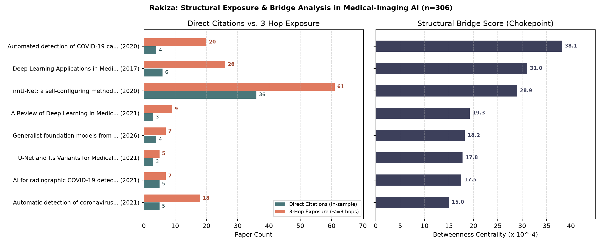

# Rakiza (ركيزة)
**Embedded Relate graph context engine & MCP server for researchers and AI agents to audit age-adjusted structural reach, simulate node-ablation impact, and trace retraction exposure footprints.**



## Use case
Flat citation counts fail to capture structural risks inside scientific bibliographies:
- **Relative hidden pillars (`ask.py`):** Rather than an arbitrary cutoff, Rakiza filters for papers at or below the in-sample median direct citation count (`direct <= 2`, sample mean `1.98`) that still achieve high 3-hop structural reach (`>= 15`), normalized by publication age (`reach_per_yr`).
- **Temporal edge auditing & interactive impact simulation (`--simulate`):** OpenAlex metadata contains `23/605` (`3.8%`) year-inverted citations (`citing_year < cited_year`, typically early-access vs. final issue dates). Rakiza tags every edge with `r.temporal_valid` inside `graph.rl`, reports both raw and temporally cleaned ablation metrics, and lists the exact downstream studies severed when a chokepoint paper is removed.
- **Agentic reference auditing (`--json` & `mcp_server.py`):** AI agents connect over standard `stdio` MCP (`JSON-RPC 2.0`) or CLI `--json` to audit references, inspect multi-hop citation chains, and insert missing papers live.

**Relationships modeled:** Directed citations `(:Paper)-[:CITES {temporal_valid}]->(:Paper)` where `a -[:CITES]-> b` means paper `a` cites `b`.

## How it uses Relate
- **Mode:** `single file` (`./graph.rl` and `./case.rl`)
- **Division of responsibility:** Python/NetworkX computes specialized graph-theoretic metrics (`bridge` betweenness, `pagerank`, and unbounded `ablation_loss`), while `Relate` provides the zero-server, portable single-file graph store, node/edge property persistence (`temporal_valid`, `ablation_loss`, `temporal_tier`), multi-hop Cypher traversal (`[:CITES*1..3]`), and CLI/MCP context interface.
- **What the graph models:**
  - **Nodes:** `(:Paper)` storing `id`, `title`, `year`, `date`, `cites`, `retracted`, `bridge`, `pagerank`, `ablation_loss` (temporally clean), `ablation_raw`, and `temporal_tier` (in `case.rl`).
  - **Edges:** `(:Paper)-[:CITES {temporal_valid}]->(:Paper)`.

## Key Findings
1. **Temporal Graph Cleaning (Before vs. After in `graph.rl` — 306 papers, 605 total edges):** Flagging `23` year-inverted edges (`r.temporal_valid = false`, leaving `582` valid edges) removes artificial backward paths from 2025–2026 papers to earlier studies (`6/10` Top-10 overlap before vs. after cleaning; `metrics_comparison.json`). *nnU-Net: a self-configuring method for deep learning-based biomedical image segmentation* (2020) rises to the #1 chokepoint (`220` clean lost reachability pairs vs. `214` raw, as removing inverted edges eliminates artificial bypass paths), while *Automated detection of COVID-19 cases using deep neural networks with X-ray images* (`W3017855299`, 2020) moves from #1 (`344` raw) to #2 (`175` clean), and a 2026 foundation-model paper drops from `167` raw to `56` clean (below the 2021 review at `78` clean).
2. **4-Metric Structural Comparison (`metrics_comparison.json`):** Across `graph.rl`, clean `ablation_loss` correlates strongly with `betweenness` (`Spearman = 0.9312`, Top-10 overlap `6/10`), while diverging sharply from `pagerank` (`Spearman = 0.546`, overlap `2/10`) and direct `in_cites` (`Spearman = 0.5895`, overlap `2/10`). Structural metrics expose bottlenecks invisible to citation counts and PageRank, while `--simulate` identifies the exact affected papers.
3. **Multi-Regime Sample Sensitivity (`sensitivity.json`, tie-aware Spearman):**
   - `Top-20/yr` (`n=251`): Top-10 overlap `8/10`, Spearman `0.9318`
   - `Top-15/yr` (`n=192`): Top-10 overlap `8/10`, Spearman `0.8703`
   - `Top-10/yr` (`n=130`): Top-10 overlap `7/10`, Spearman `0.7995`
   - `Random 70% subsamples (30 runs, n=214)`: mean Top-10 overlap `5.07/10` (moderate stability), mean Spearman `0.8258`
4. **Retraction Exposure Footprint (`case.rl` — Root `W4224073284`):** Tracks `372` citing papers (`373` nodes, `403` edges, `31` between citers) of retracted review *"U-Net-Based Medical Image Segmentation"* (retracted Oct 18, 2023), segmented into five tiers stored on nodes: `POST_12M_PLUS` (`142`), `PRE_NOTICE` (`77`), `LAG_0_6M` (`69`), `POST_6_12M` (`53`), and `AMBIGUOUS_DATE` (`31`, `-01-01` placeholder or `year=0`). Manual full-text audit of *Ling et al., Plant Methods 2023* (`10.1186/s13007-023-01096-w`, received May 2023) confirmed background-only mention and editorial lag.

## Setup and run
- **Prerequisites:** Relate CLI (`v1.0.2+`, install per official Relate documentation) and Python 3.10+ (zero external Python packages required for `ask.py`, `audit.py`, `sensitivity.py`, `mcp_server.py`, and `test_rakiza.py`).
- **Full rebuild pipeline order:** `fetch.py` -> `build_graph.py` -> `bridge.py` -> `upgrade_science.py` -> `case.py` -> `sensitivity.py` -> `make_chart.py`.

```bash
git clone https://github.com/ii8ll8iik-crypto/rakiza.git
cd rakiza

# 1. Run automated unit, Relate consistency & MCP resilience tests
python3 -m unittest -v test_rakiza.py

# 2. Run all 5 temporally cleaned structural & retraction tables
python3 ask.py

# 3. Agent & researcher contextual audit with citation chains
python3 audit.py W4224073284 10.1186/s13007-023-01096-w --json

# 4. Interactive node-removal impact simulation
python3 audit.py W3017855299 --simulate

# 5. Multi-regime sample sensitivity verification
python3 sensitivity.py

# 6. Standard stdio MCP server for AI agents
python3 mcp_server.py
```

## Where the data lives
- `./graph.rl` — Persistent single-file Relate store for the medical-imaging AI corpus (`306` papers, `605` edges with `temporal_valid` flags).
- `./case.rl` — Persistent single-file Relate store for retracted root `W4224073284` (`373` nodes, `403` citations).
- `./works.json`, `./bridge.json`, `./ablation.json`, `./metrics_comparison.json`, `./sensitivity.json`, `./case.json` — Raw and intermediate snapshots.

## Methodological Limitations
1. **Subgraph boundary & year coverage:** `graph.rl` selects up to 25 top-cited works per year in OpenAlex (`n=306`; `2014` has `12` available papers and `2015` has `19`, while `2016–2026` have `25` each). Sensitivity checks perturb this sample but do not replace an unseeded full-field crawl.
2. **Same-year cycles & temporal flags:** Filtering `citing_year < cited_year` removes `23` cross-year inversions (`582` edges retained), though same-year citations can still form local cycles.
3. **Bounded 3-Hop Reach vs. Unbounded Ablation:** `structural_reach_3hop` counts citing works within `<=3` hops, whereas `ablation_lost_reachability_pairs` evaluates unbounded transitive reachability across temporally valid edges. Neither replaces full-text inspection for experimental research dependence.
4. **Dynamic live update scope:** `--add-live` inserts the missing work into `graph.rl` in a single write batch, links in-sample references and snapshot citers (`works.json`), and updates `ablation_loss`, while leaving `bridge`/`pagerank` at `0.0` (`not_computed`) and `case.rl` unmodified.
